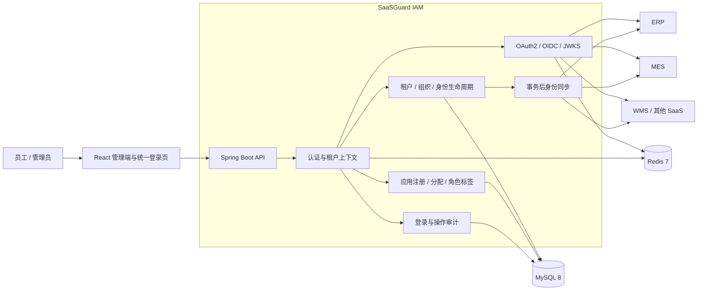

# SaaSGuard IAM

[](https://github.com/wenpeifeng/saasguard-iam/actions/workflows/ci.yml)
[](LICENSE)
[](https://openjdk.org/projects/jdk/21/)
[](https://spring.io/projects/spring-boot)
[](https://react.dev/)

> 面向 SaaS 产品和企业应用的可扩展、多租户身份与访问管理平台。

SaaSGuard IAM 将人员主档、组织、租户、应用入口、协议认证与安全审计统一收口，为 ERP、MES、WMS、门户及后续 SaaS 应用提供统一登录、应用授权和实时身份同步。仓库包含可重复执行的数据库迁移与虚构演示数据，首次启动即可体验两个相互隔离的租户。

## 目录

- [项目定位](#项目定位)
- [核心能力](#核心能力)
- [系统架构](#系统架构)
- [技术栈](#技术栈)
- [核心难点与解决方案](#核心难点与解决方案)
- [项目亮点](#项目亮点)
- [一键启动](#一键启动)
- [一键关闭](#一键关闭)
- [初始化数据](#初始化数据)
- [OIDC 接入](#oidc-接入)
- [开发与验证](#开发与验证)
- [生产部署注意事项](#生产部署注意事项)

## 项目定位

业务系统不应各自维护一套人员账号。SaaSGuard IAM 作为身份事实源，负责：

- 总部或租户管理员维护员工入职、调岗、停用、离职和密码；
- 为员工分配可访问的应用与应用声明的角色标签；
- 以 OAuth 2.0 / OIDC 为业务系统提供统一登录和令牌；
- 在身份或授权变更后通知子系统，并提供全量/增量对账接口；
- 按 `tenant_id` 隔离业务数据，平台超级管理员才能显式切换租户视角；
- 记录登录、人员生命周期、授权变化和管理操作审计。

SaaSGuard IAM 管“谁能进入哪个系统”；ERP、MES 等业务系统管“进入系统后能看什么、做什么”。认证中心不保存业务系统的菜单、按钮或业务数据权限。

## 核心能力

| 领域 | 已实现能力 |
|---|---|
| SaaS 租户 | 租户目录、状态、有效期、套餐、用户配额、域名、品牌主色、语言、时区、首位租户管理员原子初始化 |
| 身份生命周期 | 入职建号、档案维护、调岗留痕、全局停用/恢复、离职终态、统一密码重置、不可变种子账号 |
| 组织管理 | 集团/公司/部门/车间/班组等组织类型、树形管理、编码与层级校验 |
| 应用与授权 | OAuth2 Client 注册、密钥单次展示与重置、用户应用分配、应用级启停、角色标签 |
| OIDC/OAuth2 | Authorization Code + PKCE S256、RS256 Access/ID Token、JWKS、Discovery、UserInfo、Logout、Client Credentials |
| 身份同步 | 子系统用户全量/增量查询、事务提交后异步通知、应用级档案维护与对账 |
| 安全控制 | 租户边界、JWT 在线状态、应用停用/密钥重置立即失效、敏感请求字段脱敏 |
| 审计 | 登录成功/失败、IP、UA、人员生命周期、授权变化和管理写操作 |
| 管理控制台 | 租户、主账号、组织、应用、授权、登录日志和操作日志，支持平台与租户管理员分级授权 |

> 当前协议层实现项目所需的 OIDC 核心子集，并非完整认证服务器认证声明。MFA、WebAuthn、SAML、SCIM 2.0 标准端点等能力列在路线图中。

## 系统架构



### 后端模块依赖

```text
auth-common
    └── auth-framework          公共安全、租户、审计、分页基础设施
          └── auth-platform-system   租户、平台 RBAC、审计
                └── auth-platform-idm     组织、人员与生命周期
                      ├── auth-biz-app     应用、分配与同步
                      ├── auth-biz-oidc    协议端点与令牌
                      └── auth-bootstrap   可执行服务聚合
```

依赖只允许由上向下，避免领域模块循环引用。详细设计见 [SaaS 多租户 IAM 架构](docs/SaaS多租户IAM架构.md)。

### 多租户边界

- `iam_tenant` 是平台共享租户目录；人员、组织、应用、分配、生命周期和审计数据按租户隔离；
- MyBatis-Plus 租户拦截器自动补充查询与写入条件；共享表必须进入显式白名单；
- 普通主体锁定 JWT 中的 `tenantId`，不能通过请求头越权切换；
- 平台超级管理员使用 `X-Tenant-Id` 显式进入目标租户；
- 授权码、用户令牌、服务令牌和异步事件都携带租户信息，防止跨线程或跨协议丢失边界。

## 技术栈

| 层级 | 技术 |
|---|---|
| 后端语言与框架 | Java 21、Spring Boot 3.3.5、Spring Security |
| 数据访问 | MyBatis-Plus 3.5.7、HikariCP、MySQL 8 |
| 数据库迁移 | Flyway，版本化建表与演示数据初始化 |
| 缓存与会话 | Redis 7、Lettuce |
| 协议与令牌 | OAuth 2.0、OpenID Connect、PKCE S256、JJWT、RS256、JWKS |
| API 文档 | springdoc-openapi、Swagger UI |
| 前端 | React 18、TypeScript 5、Vite 5、Ant Design 5 |
| 前端状态与请求 | TanStack Query、Zustand、Axios |
| 工程化 | Maven 多模块、pnpm、Docker Compose、GitHub Actions |
| 测试 | JUnit 5、Spring Boot Test、真实 MySQL + Redis 集成测试 |

## 核心难点与解决方案

### 1. 多租户数据隔离不仅是给 SQL 加条件

**难点：** Web 请求、异步审计、事务后事件、服务令牌和 OIDC 授权码都可能跨越线程或请求边界，任何一处丢失租户信息都会造成数据串租。

**解决：** 以 `tenantId` 作为完整调用链上下文；数据层默认隔离、共享表显式声明；异步任务在提交前捕获租户并在工作线程恢复；授权码与令牌写入租户声明并在兑换时交叉校验；集成测试使用两个租户同时验证“可见”和“不可见”。

### 2. 人员状态与应用访问状态必须分层

**难点：** 员工离职、全局停用和仅在某个应用禁用的语义不同，混在一个状态字段中会导致其他系统被误停用。

**解决：** 人员主档维护全局生命周期，用户与应用的分配关系维护应用级状态；离职是不可逆终态并覆盖应用状态；子系统只能操作本应用授权，不能改变总部人员事实。

### 3. 租户创建不能产生“有租户但不能登录”的半成品

**难点：** 创建租户还要同步创建根组织、首位管理员、管理员角色和生命周期事件，任一步失败都会留下脏数据。

**解决：** 将整个租户引导过程放在同一数据库事务中，任何步骤失败全部回滚；动态创建的租户管理员可维护，平台种子账号保持不可变。

### 4. 身份变更既要实时，又不能拖垮人事事务

**难点：** 在事务内直接调用 ERP/MES，网络超时会阻塞甚至回滚入职、离职操作；提交前通知又可能把最终回滚的数据发给子系统。

**解决：** 身份事件在事务成功提交后异步发布，事件显式携带租户和操作信息；下游失败不回滚主事务，同时保留全量/增量对账接口作为一致性兜底。

### 5. 密钥和令牌需要即时撤销能力

**难点：** 纯无状态 JWT 在应用停用、密钥重置或员工离职后，通常仍可使用到自然过期。

**解决：** 管理令牌与服务令牌在 Redis 保留在线状态；应用停用、Client Secret 重置、人员停用或离职时同步清理会话，使旧令牌立即失效。

### 6. 演示环境必须可重复，而不是依赖某台开发机

**难点：** 手工造数会导致 GitHub 下载后的数据库与作者本地不一致，无法复现功能。

**解决：** 表结构、租户、演示账号、组织、应用和授权全部由 Flyway 迁移脚本版本化管理；空数据库首次启动自动得到一致基线。

## 项目亮点

- **身份事实源清晰：** 人员从认证中心进入，子系统只消费人员副本并管理自身业务权限；
- **租户全链路隔离：** 数据库、JWT、OIDC 授权码、服务 API、异步事件和审计统一携带租户；
- **协议和业务解耦：** OIDC 负责身份与登录，应用内 RBAC/ABAC 仍由业务系统自主治理；
- **令牌可即时失效：** 弥补纯 JWT 只能等待过期的风险；
- **可复现演示数据：** 新环境首次启动即可看到与仓库一致的租户、人员和应用数据；
- **单仓完整交付：** 后端、前端、数据库迁移、容器编排、演示脚本、CI 与中文文档齐全；
- **一键本地运维：** 自动检查环境、启动依赖、构建项目、等待健康检查，并只停止本项目管理的进程。

## 项目结构

```text
saasguard-iam/
├── auth-backend/
│   ├── auth-base/             # 公共模型、框架、多租户与安全基础设施
│   ├── auth-platform/         # system（租户/审计/RBAC）+ idm（用户/组织）
│   ├── auth-biz/              # app（应用授权/同步）+ oidc（协议端点）
│   └── auth-bootstrap/        # 可执行服务
├── auth-web/                  # React 管理控制台与 OIDC 登录/授权页
├── script/
│   ├── sh/                    # start-all/stop-all/status-all 一键运维脚本
│   ├── sql/migration/         # Flyway 建表与初始化数据
│   └── demo/                  # 演示数据与 OIDC 流程脚本
├── docs/                      # 架构、接入、验收和模块文档
└── docker-compose.yml         # MySQL 8 + Redis 7
```

## 一键启动

### 环境要求

一键脚本会构建并启动服务，但不会替你安装开发工具。请先准备：

| 工具 | 最低要求 | 用途 |
|---|---|---|
| Bash | 3.2+ | 执行 macOS/Linux 启停脚本；Windows 推荐 WSL2 |
| JDK | 21 | 编译和运行后端 |
| Maven | 3.9+ | 后端多模块构建 |
| Node.js | 20+ | 前端运行时 |
| pnpm | 9+ | 前端依赖管理 |
| Docker | 支持 Compose v2 | 运行 MySQL 与 Redis |
| curl | 任意现代版本 | 健康检查 |

macOS 可使用 Homebrew 安装主要依赖：

```bash
brew install openjdk@21 maven node pnpm
```

确保 Docker Desktop 已启动，然后在仓库根目录执行：

```bash
./script/sh/start-all.sh
```

脚本会依次执行：

1. 检查 Docker、JDK 21、Maven、Node.js、pnpm 和 curl；
2. 创建或启动 MySQL 8 与 Redis 7，并等待健康检查通过；
3. 构建后端、执行 Flyway 迁移、后台启动 Spring Boot；
4. 按锁文件安装前端依赖、后台启动 Vite；
5. 等待前后端健康检查通过并输出访问地址。

脚本支持重复执行：已由当前仓库启动的进程会被识别并跳过；如果端口被其他进程占用，脚本会明确报错，不会直接杀死其他项目。

### 启动选项

```bash
./script/sh/start-all.sh --backend-only             # 只启动基础设施和后端
./script/sh/start-all.sh --web-only                 # 只启动前端
./script/sh/start-all.sh --no-infra --backend-only  # 后端使用外部/已有 MySQL、Redis
./script/sh/start-all.sh --skip-build               # 使用已有后端 JAR
./script/sh/start-all.sh --skip-install             # 使用已有前端 node_modules
./script/sh/start-all.sh --help                     # 查看全部选项
```

### 服务地址

| 服务 | 地址 |
|---|---|
| 管理控制台 / 统一登录页 | <http://localhost:5174> |
| 后端 API | <http://localhost:8082/api> |
| Swagger UI | <http://localhost:8082/api/swagger-ui.html> |
| OIDC Discovery | <http://localhost:8082/api/.well-known/openid-configuration> |
| MySQL | `localhost:13306`，数据库 `auth_db` |
| Redis | `localhost:16379` |

### 状态与日志

```bash
./script/sh/status-all.sh
tail -f logs/backend.log
tail -f logs/frontend.log
docker logs -f auth-mysql
docker logs -f auth-redis
```

`.run/` 保存本次启动的 PID，`logs/` 保存运行日志，两个目录都不会提交到 Git。

## 一键关闭

仅关闭前后端，保留 MySQL、Redis 和现有数据：

```bash
./script/sh/stop-all.sh
```

同时停止前后端、MySQL 和 Redis，但保留 Docker 数据卷：

```bash
./script/sh/stop-all.sh --with-infra
```

下次执行 `./script/sh/start-all.sh` 会继续使用原有数据。需要彻底清空本地数据库并重新生成演示基线时，可执行以下命令：

```bash
./script/sh/stop-all.sh --with-infra
docker compose down -v
./script/sh/start-all.sh
```

> `docker compose down -v` 会永久删除当前项目的本地 MySQL/Redis 数据卷，请确认没有需要保留的数据后再执行。

## 手动启动

需要单独调试某个组件时，可以不用一键脚本：

```bash
# 1. 基础设施
docker compose up -d mysql redis

# 2. 后端（必须从仓库根目录启动，Flyway 使用相对路径）
export JAVA_HOME=/path/to/jdk-21
mvn -f auth-backend/pom.xml -DskipTests package
java -jar auth-backend/auth-bootstrap/target/saasguard-iam-server-1.0.0-SNAPSHOT.jar \
  --spring.profiles.active=dev

# 3. 前端
cd auth-web
pnpm install --frozen-lockfile
pnpm dev
```

## 初始化数据

### 开箱即用租户

| 租户代码 | 账号 | 密码 | 权限 | 用途 |
|---|---|---|---|---|
| `demo` | `admin` | `123456` | 平台超级管理员 | 租户管理和跨租户运维 |
| `acme-demo` | `acme_admin` | `123456` | 租户管理员 | 验证租户内人员、组织、应用与审计隔离 |

`demo` 还包含 `E3001`～`E3006` 只读演示员工与 `E3101`～`E3105` 可维护入职员工，演示口令均为 `123456`。这些数据由 Flyway 创建，任何人克隆仓库并在空数据库首次启动，都会得到相同基线。

可选演示脚本：

```bash
./script/demo/seed-demo-data.sh    # 幂等补充边界状态演示数据
./script/demo/demo-client-flow.sh  # 演示 OIDC Authorization Code + PKCE 流程
```

> 所有账号、组织和应用均为虚构数据。演示口令只能用于本地体验，不能用于共享或生产环境。

## OIDC 接入

- 管理端登录 JSON 携带 `tenantCode`；
- 授权入口查询参数携带 `tenant_code`；
- `/oauth/token` 请求携带租户代码，应用凭证只在该租户内校验；
- 授权码绑定租户、Client、Redirect URI 和 PKCE Challenge；
- Access Token、ID Token、Service Token 均包含 `tenantId`；
- PKCE 只接受 `S256`，不允许降级为 `plain`；
- 应用使用 Discovery 和 JWKS 完成端点发现与 RS256 验签。

详细端点、Claims 和接入步骤见 [业务系统接入指南](docs/业务系统接入指南.md)。

## 开发与验证

### 后端构建与测试

```bash
mvn -f auth-backend/pom.xml test
mvn -f auth-backend/pom.xml -DskipTests package
```

### 前端构建

```bash
cd auth-web
pnpm install --frozen-lockfile
pnpm build
```

### 脚本静态检查

```bash
bash -n script/sh/*.sh
```

GitHub Actions 会执行前端生产构建、后端打包和身份链路集成测试。集成测试覆盖人员生命周期、应用分配、OIDC、离职失效、组织规则、并发工号、租户隔离和服务令牌撤销。

## 生产部署注意事项

当前 Docker Compose 与 `dev` 配置面向本地开发。部署到共享或生产环境前至少需要：

- 删除或禁用演示账号，强制管理员首次登录改密；
- 替换数据库、Redis、身份同步令牌等默认凭证，并通过密钥管理服务注入；
- 使用独立的 OIDC 签名密钥并建立轮换、备份和恢复机制；
- 将 Issuer、Redirect URI、Cookie、CORS 配置切换为正式 HTTPS 域名；
- 为数据库启用备份、最小权限账号、TLS 和高可用；
- 为 Redis 启用专有网络、ACL、TLS、持久化和高可用；
- 增加网关限流、登录失败锁定、MFA、监控告警和集中日志；
- 使用容器编排或进程守护系统运行服务，不应使用本地开发脚本承担生产守护职责；
- 完成依赖漏洞、许可证、渗透测试和灾备演练后再正式上线。

安全问题请遵循 [安全策略](SECURITY.md) 私下报告，不要公开漏洞利用细节。

## 相关文档

- [SaaS 多租户 IAM 架构](docs/SaaS多租户IAM架构.md)
- [系统概览](docs/系统概览.md)
- [业务系统接入指南](docs/业务系统接入指南.md)
- [身份管理链路验收](docs/身份管理链路验收.md)
- [前端 UI 基线](auth-web/UI_STANDARDS.md)
- [贡献指南](CONTRIBUTING.md)
- [安全策略](SECURITY.md)

## 路线图

- 基于 Spring Authorization Server 的完整 OAuth 2.1 / OIDC Provider；
- MFA/TOTP、WebAuthn/Passkey、短信与邮件挑战；
- SCIM 2.0、标准 Webhook Outbox、重试退避、失败重放与死信处理；
- SAML 2.0、外部企业 IdP 联邦和社交身份；
- 会话中心、设备管理、风险策略与租户级安全基线；
- 套餐能力开关、配额计量和租户自助品牌域名；
- 管理员委托、资源范围授权与更细粒度 ABAC。

## 开源协议

SaaSGuard IAM 使用 [MIT License](LICENSE) 开源。代码库只保留通用实现、公开依赖与虚构演示数据；请勿提交真实客户资料、生产密钥、私有仓库地址或内部基础设施配置。
